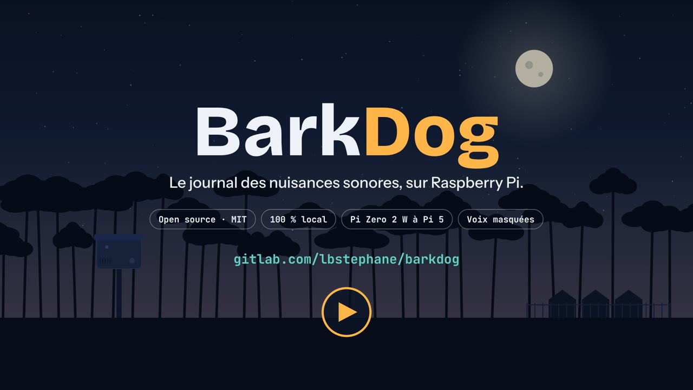

# BarkDog 🐕 — journal des nuisances sonores

🇬🇧 [English](README.md) · 🇫🇷 **Français**

[](https://gitlab.com/lbstephane/barkdog/-/pipelines)

Site : **[barkdog.fr](https://barkdog.fr)** · Développement, tickets et contributions sur **[GitLab](https://gitlab.com/lbstephane/barkdog)** (le dépôt GitHub est un miroir).

**BarkDog** est un enregistreur autonome pour Raspberry Pi. Il écoute en continu, reconnaît les nuisances choisies grâce à une IA (aboiements, hurlements, coqs, musique, travaux, pétards…) et ne garde que les épisodes. Chaque épisode est **horodaté, catégorisé et scellé par une empreinte SHA-256**. Une page web permet de tout consulter depuis un téléphone.

[](https://barkdog.fr/)

La vidéo de 36 secondes se regarde sur [barkdog.fr](https://barkdog.fr/), ou se télécharge : [16:9](docs/barkdog.mp4) · [verticale, pour les réseaux sociaux](docs/barkdog-vertical.mp4).

Le but : constituer un dossier factuel (dates, heures, durées, répétition, de nuit ou de jour) sans passer ses nuits le dictaphone à la main.

> **Ce n'est pas un instrument de mesure.** Les niveaux sont relatifs (micro non calibré). L'outil aide à documenter une nuisance, mais ne remplace ni une mesure acoustique réglementaire, ni un constat de commissaire de justice.

## Fonctionnalités

- **Détection locale par IA** : [YAMNet](https://github.com/tensorflow/models/tree/master/research/audioset/yamnet) (Google, 521 classes de sons AudioSet), analyse toutes les 0,5 s. Aucun son ne sort du boîtier.
- **Nuisances au choix** dans la page, avec un seuil par nuisance si besoin : animaux, musique, travaux, pétards, moteurs, alarmes, **avions et hélicoptères**, **trafic routier**… **Nuisances personnalisées** : n'importe quel son parmi les 521 connus de l'IA (ventilateur, pompe à chaleur, bourdonnement…). **Sons à ignorer** : canards, oiseaux, pluie, circulation… **Déclenchement facultatif sur le niveau sonore** seul.
- **Épisodes complets** : les secondes qui précèdent le déclenchement sont conservées, et l'épisode se clôt après un calme réglable. Un son isolé peut être écarté (nombre minimum de détections), mais il reste tracé.
- **Chronologie** dans chaque fichier : une frise par catégorie et des boutons « 0:34 hurlement » pour aller directement au bon moment.
- **Vie privée** : les passages où l'IA entend une voix humaine sont **rendus muets** dans les fichiers (par défaut), et signalés sur la frise.
- **Traçabilité** : empreinte SHA-256 de chaque WAV ; **journal chaîné** (chaque ligne contient l'empreinte de la précédente : une ligne modifiée ou supprimée après coup se voit) et **vérification d'intégrité** en un clic ; identifiant des réglages utilisés ; historique des démarrages, arrêts, changements de réglages, suppressions et modes test ; journal des épisodes écartés.
- **Page web** pour iPhone et Android :
  - état de l'écoute, bouton marche / arrêt ;
  - bandeau « enregistrement en cours », liste mise à jour toute seule ;
  - filtres, statistiques par jour et la nuit, exports CSV ;
  - niveau moyen de chaque épisode (pendant les détections) et **fiabilité par catégorie**, calculée à partir des faux positifs que vous marquez ;
  - annotations (faux positif, notes) et corbeille ;
  - **mode test** avec les scores de l'IA en direct, sans enregistrer ;
  - interface en **français ou en anglais**, au choix dans les Réglages.
- **Durci** : mot de passe haché, session signée, anti-CSRF, CSP stricte, limitation des tentatives, services systemd cloisonnés (voir [Sécurité](#sécurité)).

## Matériel

| | Recommandé | Remarques |
|---|---|---|
| Carte | **Raspberry Pi Zero 2 W**, 3, 4 ou 5 | **Raspberry Pi OS 64 bits** obligatoire (Lite suffit). |
| Micro | **Micro USB** (micro-cravate USB, carte son USB et micro) | Un micro-cravate USB à une dizaine d'euros suffit. Évitez les micros de conférence à « réduction de bruit » : ils effacent les aboiements lointains. La prise jack du Pi 3 et du Pi 4 est **une sortie seulement**. |
| Alimentation | 5 V 2,5 A (Pi 3 / Zero 2 W), 5 V 3 A en USB-C (Pi 4) | Une alimentation de 1 A suffit à empêcher le démarrage. |
| Stockage | Carte microSD de 16 Go | Environ 1,9 Mo par minute enregistrée. |

À savoir :
- **Pi Zero 2 W** : un seul port USB de données (adaptateur OTG nécessaire pour le micro), Wi-Fi 2,4 GHz uniquement. Dans un boîtier étanche, gare à la chaleur au soleil : prévoir ombre, couleur claire, aération à chicane.
- **Ronflement électrique** : avec une alimentation à découpage ou une boucle de masse sur l'USB, on entend les harmoniques du 50 Hz (150, 250, 350 Hz…). Le filtre coupe-bas à 200 Hz retire les plus basses. Si le bourdonnement persiste, changez d'alimentation (l'officielle de préférence) ou ajoutez un isolateur USB, un hub alimenté ou un ferrite sur le câble du micro.
- **Heure** : le Pi n'a pas d'horloge sauvegardée. Il faut du réseau au démarrage (NTP), ou un module RTC DS3231. La page signale une heure non synchronisée.

## Installation

```bash
git clone https://gitlab.com/lbstephane/barkdog.git ~/barkdog
cd ~/barkdog
./install.sh
```

Le script installe les dépendances et le modèle, règle l'heure, demande le mot de passe de la page et crée deux services démarrés au boot :
- `barkdog` : l'écoute ;
- `barkdog-web` : la page, sur le port 8080.

**Micro USB à 48 kHz uniquement** (cas courant) : laissez ALSA convertir en 16 kHz. Créez `/etc/asound.conf` avec le nom de carte donné par `arecord -l`, puis choisissez le micro « default » dans les Réglages :

```
pcm.!default { type asym capture.pcm "mic" playback.pcm "plughw:0,0" }
pcm.mic { type plug slave.pcm "hw:CARD=Device,DEV=0" }
```

**Mise à jour** : `git pull && ./install.sh`. Les enregistrements, le mot de passe et les réglages sont conservés.

## Utilisation

Ouvrez **http://\<nom-du-pi\>.local:8080** depuis le Wi-Fi de la maison. Sur iPhone, utilisez « Partager → Sur l'écran d'accueil ».

1. **Réglages** : cochez les nuisances, ajustez le micro, le gain et le filtre. Pour un bruit absent de la liste, « Ajouter une nuisance personnalisée » : lancez le mode test pendant le bruit, la ligne « L'IA entend surtout » donne les noms de sons à choisir. Les changements s'appliquent en quelques secondes, sans couper l'écoute ; seul un changement de micro la redémarre, pour environ 10 s.
2. **Mode test** : affiche les scores en direct face aux seuils, le niveau, ce que l'IA « entend » et les détections de voix. Par défaut, rien n'est enregistré pendant le test. La suspension expire seule 5 min après la fermeture de la page, et au bout de 30 min de test au maximum.
3. **Épisodes** : écoute, frise, annotations, corbeille. Une suppression définitive n'est possible que depuis la corbeille, et la ligne reste dans le journal brut.
4. **Exports** : « Vérifier l'intégrité » recalcule la chaîne du journal et l'empreinte de chaque fichier ; le résultat est noté dans l'historique.

**Accès depuis l'extérieur** : n'ouvrez **pas** de port sur votre box. Utilisez un VPN : [Tailscale](https://tailscale.com) (rien à configurer sur la box) ou WireGuard.
- Avec Tailscale, `sudo tailscale serve --bg 8080` ajoute le HTTPS. Le cookie de session passe alors en `Secure`.
- Pensez à désactiver l'expiration de clé du boîtier dans la console Tailscale.

## Fichiers produits

```
enregistrements/
  2026-10-16/
    2026-10-16_05h42m10s_aboiement+hurlement.wav   # l'épisode (16 kHz mono)
    2026-10-16_05h42m10s_aboiement+hurlement.json  # chronologie + passages de parole masqués
  journal_evenements.csv     # 1 ligne par épisode : horaires, catégories, scores, niveaux, SHA-256, réglages, chaîne
  journal_evenements_v1.csv  # journal 1.0 archivé tel quel lors de la mise à jour (point de départ de la chaîne)
  episodes_ignores.csv       # épisodes écartés (trop courts, parole…) : jamais d'oubli silencieux
  historique_ecoute.csv      # démarrages, arrêts, réglages, suppressions, mode test, connexions
  annotations.json           # faux positifs, notes, corbeille (le journal n'est jamais modifié)
  corbeille/
config/                      # (0700) réglages, mot de passe haché, clé de session
```

Colonnes du journal ajoutées en 1.1 : `niveau_detections_dBFS` (niveau moyen pendant les seules détections) et `chaine`. `niveau_moyen_dBFS` exclut désormais les passages de parole masqués. Les niveaux sont en dBFS, relatifs au micro.

**Journal chaîné** : `chaine` = SHA-256 de « chaîne de la ligne précédente `;` autres colonnes de la ligne séparées par `;` ». La première ligne part de 64 zéros, ou de l'empreinte du journal 1.0 archivé. À la mise à jour vers la 1.1, le journal 1.0 n'est pas réécrit : il est archivé tel quel et son empreinte est notée dans l'historique.

Outils en ligne de commande :
- `.venv/bin/python integrite.py [--sans-fichiers]` vérifie la chaîne du journal et l'empreinte de chaque fichier (sans rien modifier) ;
- `.venv/bin/python reanalyse.py [--force]` recalcule les chronologies avec les réglages actuels ;
- `.venv/bin/python rapport.py` produit une synthèse par jour ;
- `.venv/bin/python auth.py --set` change le mot de passe.

## Sécurité

Modèle de menace : la page est destinée au **réseau local et à un VPN**, jamais à Internet en direct. Elle donne accès à des enregistrements sensibles, et permet de supprimer des fichiers et d'arrêter l'écoute.

- **Authentification** :
  - mot de passe haché en PBKDF2-SHA256 (200 000 itérations, sel aléatoire), fichier en 0600 ;
  - session par jeton signé HMAC-SHA256, valable 30 jours, en cookie `HttpOnly` et `SameSite=Strict` ;
  - changer le mot de passe ferme toutes les sessions ;
  - 5 échecs en 15 min bloquent l'adresse.
- **Anti-CSRF** : chaque requête POST exige un en-tête applicatif et une origine identique ; la connexion elle-même est protégée.
- **En-têtes** : CSP sans script inline, `frame-ancestors 'none'`, `nosniff`, `no-referrer`. La signature du serveur ne révèle aucune version.
- **Chemins** : les fichiers sont confinés au dossier des enregistrements, résolus puis contrôlés ; les noms de téléchargement sont nettoyés.
- **systemd** :
  - l'écoute tourne sans privilège (`NoNewPrivileges`), sans réseau (`AF_UNIX` seul), avec un système de fichiers en lecture seule sauf pour les données et les réglages ;
  - la page web est cloisonnée de la même façon, à l'exception de `NoNewPrivileges`, nécessaire au bouton marche / arrêt.
- **sudo** : une seule règle, limitée à `systemctl start|stop barkdog`.
- **Traçabilité** : connexions, réglages, suppressions et marche / arrêt sont inscrits dans l'historique ; les refus apparaissent dans `journalctl -u barkdog-web`.
- **Analyse du code à chaque push** : CodeQL (GitHub), Semgrep SAST et recherche de secrets (CI GitLab), alertes Dependabot sur les dépendances.

Une vulnérabilité ? Merci de la signaler en privé avant toute publication, par un [ticket confidentiel sur GitLab](https://gitlab.com/lbstephane/barkdog/-/issues/new) (case « This issue is confidential »).

## Vie privée et cadre légal

- Enregistrer **les paroles d'autrui** prononcées à titre privé sans leur consentement est puni par la loi en France (article 226-1 du Code pénal). Le masquage de la parole est activé par défaut. Le désactiver est de votre responsabilité.
- Orientez le micro vers la source de la nuisance, pas vers les habitations ou les lieux de passage.
- En France, les bruits de comportement (animaux, cris, musique…) s'apprécient selon leur **durée, leur répétition ou leur intensité**. Les bruits d'activités relèvent d'une mesure d'émergence au sonomètre. Le journal aide à objectiver la répétition et les horaires. Pour une procédure, rapprochez-vous de l'ADIL, d'un conciliateur, d'un avocat ou d'un commissaire de justice.

## Questions fréquentes

**Le masquage des voix « casse »-t-il la valeur du fichier ?** Le fichier scellé est celui que le boîtier a enregistré, voix déjà rendues muettes. Rien n'est caché pour autant : chaque passage masqué est horodaté dans la chronologie (`.json`), visible sur la frise et compté dans le journal (`parole_masquee_s`). Un aboiement qui tombe pendant une voix est masqué avec elle : la protection de la vie privée passe en premier. Filtrer la voix en gardant l'aboiement donne des résultats trop aléatoires, et une voix mal effacée pose un problème juridique.

**Et un commissaire de justice ?** BarkDog ne remplace pas un constat. En revanche, le relevé montre quand la nuisance est la plus probable : c'est utile pour choisir le moment où faire venir un commissaire de justice, ou pour étayer une démarche auprès d'un conciliateur ou de la mairie.

**La télévision ou un enfant qui imite un chien ?** Un son court ne suffit pas si vous demandez plusieurs détections par épisode (« Détections minimum »). Le micro est fait pour l'extérieur, tourné vers la source. Les seuils et le mode test permettent d'ajuster, et la fiabilité par catégorie mesure le résultat chez vous.

**Peut-il reconnaître la race du chien, ou les espèces d'oiseaux ?** Non : YAMNet reconnaît des familles de sons (aboiement, hurlement, chant d'oiseau…), pas des races ni des espèces. Pour les oiseaux, voyez le projet libre [BirdNET-Pi](https://github.com/Nachtzuster/BirdNET-Pi).

**Et les infrabasses ?** Hors de portée : l'audio est échantillonné à 16 kHz, l'analyse de YAMNet commence vers 125 Hz et un micro USB capte mal sous 50 Hz. Le profil « Basses, percussions » couvre les basses audibles.

**Peut-il « répondre » aux chiens, ou surveiller le quartier ?** Non, et ce n'est pas prévu : BarkDog documente, il ne riposte pas, et il n'est pas un outil de surveillance du voisinage.

## Feuille de route

Voir [ROADMAP.md](ROADMAP.md).

## Développement

```bash
python3 -m unittest discover -s tests          # 43 tests, sans matériel ni modèle (micro et IA simulés)
python3 tests/demo.py --out /tmp/demo/enregistrements --config /tmp/demo/config/config.json --speed 4
python3 auth.py --config-dir /tmp/demo/config --set
python3 web.py --out /tmp/demo/enregistrements --config-dir /tmp/demo/config --no-service-control
```

La démo lance le vrai enregistreur avec un faux micro et un faux modèle. Son scénario en boucle comprend des hurlements puis des aboiements, une voix, des canards, un aboiement isolé et un hélicoptère.

Organisation du code :

| Fichier | Rôle |
|---|---|
| `catalog.py` | Nuisances, exclusions et classes de parole (correspondance vers YAMNet), nuisances personnalisées. |
| `config.py` | Réglages (`config/config.json`) : validation, empreinte, différences. |
| `bark_logger.py` | Enregistreur : détection, épisodes, masquage de la parole, niveaux, journal. |
| `integrite.py` | Journal chaîné : calcul et vérification (chaîne et empreintes des fichiers). |
| `web.py`, `auth.py`, `static/` | Page web, en bibliothèque standard Python uniquement. Traductions dans `static/i18n.js`. |

## Soutenir

BarkDog est gratuit. S'il vous rend service, vous pouvez [offrir un café sur Ko-fi](https://ko-fi.com/revolution3d). Signalements et contributions : [tickets](https://gitlab.com/lbstephane/barkdog/-/issues) et merge requests.

## Versions

Voir [CHANGELOG.md](CHANGELOG.md).

## Licence

[MIT](LICENSE), sans garantie d'aucune sorte. Vous restez seul responsable de l'usage des enregistrements, notamment au regard de la vie privée des tiers.

Le modèle YAMNet et la liste de classes (`tests/data/yamnet_class_map.csv`) sont publiés par Google sous licence Apache 2.0. Le modèle est téléchargé à l'installation, il n'est pas redistribué dans ce dépôt.
